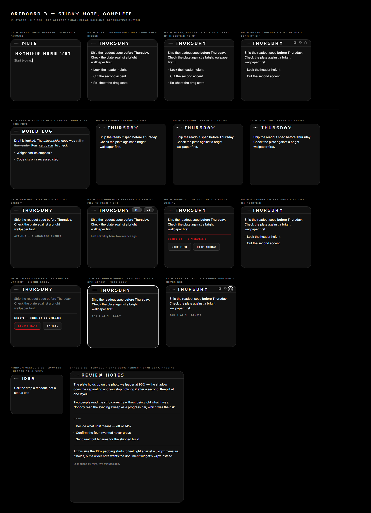
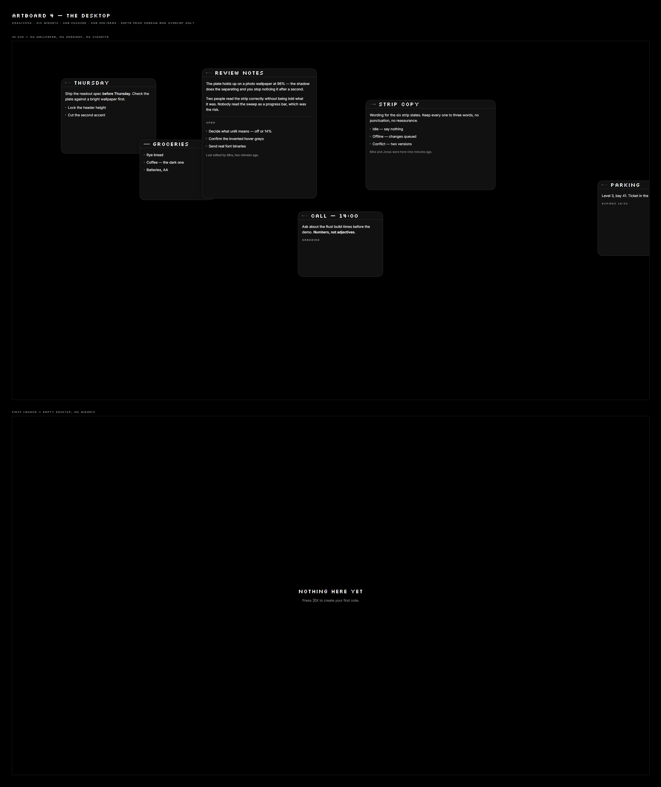
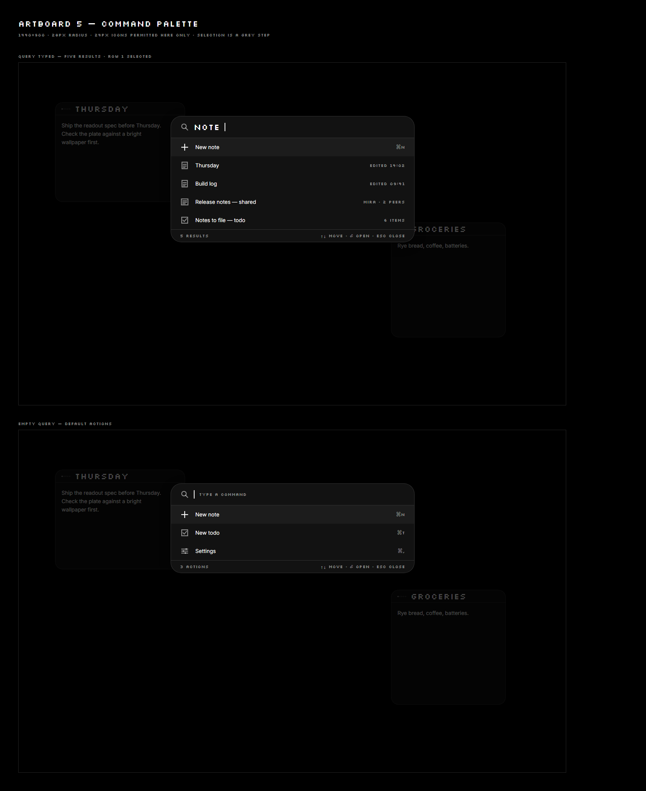
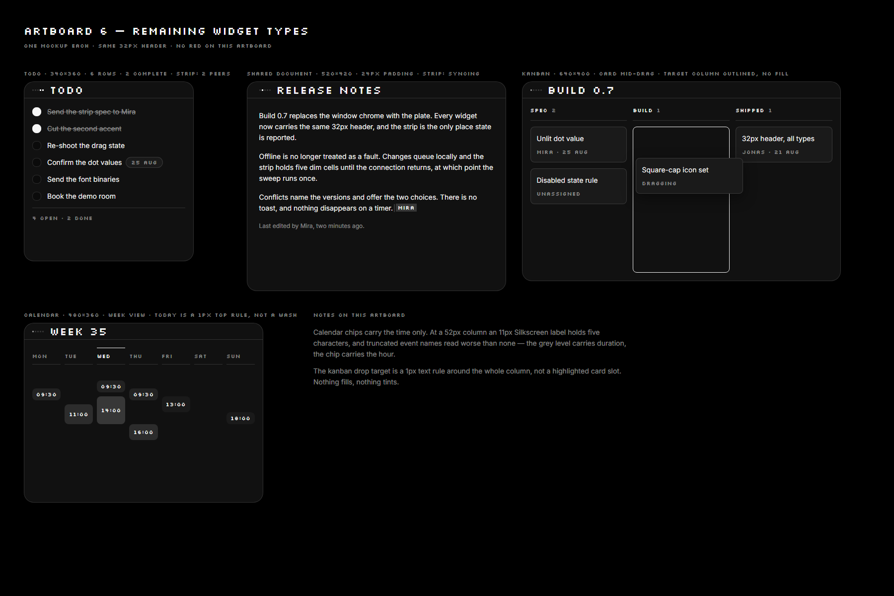

> ## ⚠ READ THIS BEFORE ANYTHING ELSE
>
> **This spec is the original brief, not the current state of the build.** Nine of its
> decisions have been deliberately overridden by the user after seeing the app run.
> Following it literally will undo working, agreed-on behaviour.
>
> **Do this first, in order:**
> 1. Read **`progress.md`** — its START HERE section has the current state, the file
>    layout, the commands, the table of what overrides this spec, and the traps already hit.
> 2. Read **`TASKS.md`** — the numbered backlog. Work from the first unticked box.
> 3. Then read this spec for design detail.
>
> **Three standing rules that are not in this document:**
> - **Write no code comments.** Anywhere. Reasoning goes in `progress.md`, `TASKS.md`
>   and commit messages.
> - **Only tick a `TASKS.md` box for behaviour you personally watched work.** Compiling
>   is not done. This has already been got wrong four times.
> - **Ask before adding any dependency** (Hard Constraint 6).
>
> The pristine original of this file is in `handoff/`. Only the five image links differ.


# Canvas — Build From Scratch

**This file is a complete project constitution.** Drop it into a fresh empty folder as `CLAUDE.md`, bring the `screenshots/` and `fonts/` folders alongside it, and hand the folder to a new Claude Code session. It contains everything that session needs: what to build, the exact design spec, real working code patterns, the hard-won implementation lessons from a prior attempt at this same build, and the staged plan to build it in.

**Read this entire file before writing any code.** It is long on purpose — the prior attempt at this build produced broken drag, invisible controls, and a stray blue accent bar because decisions got made without this level of detail. Do not skip sections.

---

## Table of contents

0. First session — do this before anything else
1. What Canvas is, and the five rules that are not negotiable
2. Hard constraints
3. Tech stack (closed — do not substitute without asking)
4. How to work (process rules, progress-file protocol)
5. Design tokens (colour, typography, spacing, radius, motion, icons)
6. Component library (Panel, GlyphStrip, Button, Checkbox, Tag, TextField, Divider, PresencePill, Icon)
7. Sticky note — full spec, 11 states
8. Desktop composition
9. Command palette
10. Other widget types (Todo, Shared Document, Kanban, Calendar) — direction with numbers
11. CRDT architecture and per-widget data shapes
12. Storage schema
13. **Slint implementation gotchas — read this before writing UI code**
14. Staged build plan with Definition of Done
15. What's in this folder / setup checklist

---

## 0. First session — do this before anything else

1. Create `progress.md` in the project root using the template in §4.3. It starts nearly empty — just the header and the standing rule. You will append to it after every unit of work.
2. Confirm the tech stack in §3 is actually available (`cargo --version`, and that `slint = "1.17"` and `yrs = "0.19"` resolve) before writing code against the API details in this file. Slint's API surface has changed between versions before; §13 documents exactly what was verified against **Slint 1.17.1** and **yrs 0.19.2**. If you're on a different version, re-verify anything you're unsure of rather than trusting this file blindly — check the pinned version's own docs.
3. Build in the stage order in §14. Do not jump ahead because a later stage looks easy — later stages assume earlier ones are actually done and tested, not just started.
4. Work in small units — one coherent piece (e.g. "the header, drag, and hover cluster"), compiling and manually verified, then stop and report before starting the next piece. The prior attempt's worst bugs came from chaining unrelated changes together and not testing between them.

---

## 1. What Canvas is

Canvas is a native, offline-first desktop widget platform in Rust. Small always-on-top windows (sticky notes first, more types later) live on the desktop, persist to local SQLite, and merge concurrent edits via CRDTs. A widget is not a window — it is a **readout**: a flat monochrome plate that shows one thing and reports its own state.

The design language: **black, white, one red, dot-matrix type, and light that reports state instead of icons that describe it.** Reference points: Nothing OS, Braun instrumentation, split-flap boards, monochrome LCD test equipment. Explicitly not: frosted glass, gradients, soft shadows, warm neutrals, any second accent colour.

### The five rules — do not break these

1. **Monochrome plus one red.** If something seems to need a second hue, it needs a different layout.
2. **Red (`#D71921`) appears twice in the whole product**: the error/conflict state and the destructive button. Never a focus ring, never an accent, never decoration.
3. **Every widget wears a Glyph Strip**, and no widget has any other status indicator — no sync icon, no online dot, no banner, no toast, anywhere.
4. **Dot cells are binary** — `text`, `dim`, `signal`, or off. Nothing between, no fade, no glow. The first opacity tween added to a dot cell destroys the product's identity.
5. **Flat and opaque.** No blur, no gradient, no glass, no glow, no tilt, no scale, no bounce.

Plus: the interface/display face renders only at 11px and 22px, body prose is always the body face, and the header strip is exactly 32px on every widget type at every size.

---

## 2. Hard constraints

Violating any of these is a failed build regardless of how well the code works.

1. **No Electron, Chromium, webview, or any browser engine.** Anywhere, for any reason, including tooling.
2. **Editing never blocks on the network.** A local edit applies to the local document and paints before anything touches a socket. If a code path can make typing wait on I/O, it is wrong.
3. **CRDTs only.** No last-write-wins merge anywhere in the codebase, not even as a temporary shortcut in a prototype.
4. **No save button, ever.** Persistence is automatic and invisible.
5. **Resource budgets are real:** single widget 5–15 MB, app idle 20–40 MB, app total under typical use < 50 MB, cold launch < 300 ms. Treat a budget regression as a build failure.
6. **The stack in §3 is closed.** Adding a dependency outside it — or swapping one for an alternative — requires asking the user first. Say what you want, why, and what it replaces.

---

## 3. Tech stack (closed)

| Layer | Choice | Notes |
|---|---|---|
| Language | Rust, edition 2021 | |
| UI | `slint` 1.17.x, `slint-build` 1.17.x | CPU software renderer by default (`SLINT_BACKEND=winit-software`). GPU (`winit-femtovg`) is opt-in only, behind a `--gpu` flag. **Never** default to GPU — the memory budget depends on software rendering. |
| CRDT | `yrs` 0.19.x (Rust port of Yjs) | Not Automerge. See §11 for exact API patterns that compiled clean against 0.19.2. |
| Storage | `rusqlite` (bundled SQLite) | Local file, e.g. `canvas_local.db`. Schema in §12. |
| Async runtime | `tokio`, on a dedicated background thread, bridged to the Slint event loop via `slint::invoke_from_event_loop` | Never block the UI thread on network I/O. |
| IDs | `uuid` 1.x, `v4` feature | |
| Allocator | `mimalloc` as `#[global_allocator]` | Measurably reduces idle RSS on Windows; keep it. |
| Networking (P2P sync) | raw WebSocket, JSON `SyncMessage { widget_id, payload }` for now | A real binary wire protocol is future work (§14 Stage 2/3), not required for the initial build. |
| Fonts | Silkscreen (interface) + Inter (body fallback), both bundled | See §5.2 and §13.1 for the exact, tested embedding mechanism. Files are in `fonts/` next to this document. |

Do not add a rich-text-editor crate, a UI framework other than Slint, a different CRDT library, or a different windowing toolkit without asking first.

---

## 4. How to work

### 4.1 Process rules

- **Small units.** One coherent change, compiling and manually verified, then stop and report. Do not chain unrelated changes into one pass.
- **Stay in scope.** Fix/build what the current stage asks. Don't refactor adjacent code or rename things for consistency unless the task requires it.
- **Ask rather than guess** on anything touching the CRDT data shape, the wire protocol, the storage schema, or a design token not already specified in this file. A wrong architectural guess propagates for weeks.
- **Verify before claiming.** `cargo check` passing is not "done." Actually run the app and interact with the feature. If you cannot test something (needs two machines, needs a real monitor unplugged), say so explicitly and mark it 🟡, not ✅.
- **Say when unsure.** Slint's and yrs's API surfaces are not fully in your training data and change between versions. §13 documents what's confirmed for the pinned versions. For anything not covered there, check the real docs for the exact installed version rather than writing plausible-looking code from memory — the prior attempt lost significant time to two wrong API guesses (`slint::register_font_from_memory`, which does not exist in 1.17, and assuming `HorizontalLayout` children respect explicit `height`/`y`, which they don't reliably).

### 4.2 Commands

```bash
cargo check --workspace
cargo clippy --all-targets -- -D warnings   # must be clean before reporting anything done
cargo test --workspace
cargo fmt --all

cargo run -p canvas-app              # standalone
cargo run -p canvas-app -- --gpu     # opt into GPU rendering (do not default to this)
```

### 4.3 `progress.md` — standing rule

**Every time something is implemented and tested, `progress.md` gets updated in the same pass.** This is the mechanism that lets a session two weeks from now pick the project up without re-deriving anything.

Status markers:

| Marker | Meaning |
|---|---|
| ✅ | Implemented and confirmed working. Name the check. |
| 🟡 | Code exists and compiles. Behaviour unconfirmed. |
| ❌ | Not started. |

Starter template — create this as `progress.md` in step 1 of §0:

```markdown
# Canvas — Progress Log

**Last updated:** YYYY-MM-DD
**Current position:** (update this line every session)

## Standing update rule

After implementing and testing anything, append a dated entry below with the
correct status marker, and downgrade or remove anything it contradicts. Do
not batch updates — a stale log is worse than no log.

Template:

### YYYY-MM-DD — <short title>
- ✅ <what now works> — verified by <manual step or test name>
- 🟡 <what landed but is untested>
```

Report format at the end of each unit of work: what changed (1–2 sentences), what you verified and how, what you did *not* verify and why, and the next item from §14.

---

## 5. Design tokens

Every number below is final. **No new colour, radius, duration, or font size gets invented anywhere in the codebase.** If a value you need isn't here, stop and ask rather than inlining a guess.

### 5.1 Colour

| Token | Dark | Light | Role |
|---|---|---|---|
| `base` | `#000000` | `#FFFFFF` | Absolute ground, widget backdrop behind the plate |
| `plate` | `#121212` @ 0.96 opacity | `#F2F2F2` @ 0.96 opacity | The widget surface |
| `text` | `#FFFFFF` | `#0A0A0A` | Primary text, lit dots |
| `dim` | `rgba(255,255,255,0.52)` | `rgba(10,10,10,0.55)` | Secondary text, unlit-but-present dots, icons at rest |
| `edge` | `rgba(255,255,255,0.14)` | `rgba(10,10,10,0.12)` | Hairlines, borders, unlit dot cells |
| `signal` | `#D71921` | `#D71921` | Destructive, error. Identical in both modes. |
| `elev-raised` | `#1C1C1C` | `#FFFFFF` | One step up (e.g. button rest fill) |
| `elev-base` | `#121212` | `#F2F2F2` | Same as plate |
| `elev-recessed` | `#0C0C0C` | `#E8E8E8` | One step down (e.g. checkbox box, inline code fill) |
| `dot-lit` | `= text` | | Glyph strip / dot cells |
| `dot-half` | `= dim` | | |
| `dot-signal` | `= signal` | | |
| `dot-unlit` | `= edge` | | |
| `peer-1..4` | `#3A3A3A` `#2E2E2E` `#242424` `#1C1C1C` | `#C8C8C8` `#D4D4D4` `#E0E0E0` `#EAEAEA` | Presence grey steps — peers are distinguished by grey level + initials, **never colour** |
| `hover-default` | `#242424` | | Button default-variant hover fill |
| `hover-primary` | `#E6E6E6` | | Button primary-variant hover fill |
| `active-primary` | `#CCCCCC` | | Button primary-variant active fill |
| `active-destructive` | `#B01319` | | Button destructive-variant hover/active fill |
| `scrim` | `rgba(0,0,0,0.72)` | | Command palette backdrop only. The one deliberate exception to "no translucency beyond the plate's 96%." |

Dark mode is primary — true black, not near-black. Light mode is a token flip; three known gaps if you build light mode: `dot-unlit` at 12% black is nearly invisible on `#F2F2F2` (use ~22% instead), the dark-mode shadow value reads as a web card on white (use `0 1px 3px rgba(0,0,0,0.10)` / drag `0 6px 20px rgba(0,0,0,0.20)`), and `dim` at 55% black fails WCAG AA (4.27:1, needs 4.5:1) — raise to ~57–58%.

### 5.2 Typography

Two faces. Interface/display face renders **only** at 11px and 22px — never any other size, never smaller than 11px.

| Role | Size / line | Weight | Face | Treatment |
|---|---|---|---|---|
| Widget title | 22 / 28 | — | Interface face | UPPERCASE, +0.06em tracking |
| Label / status word / metadata | 11 / 16 | — | Interface face | UPPERCASE, +0.08em tracking |
| Palette query line | 22 / 28 | — | Interface face | UPPERCASE, +0.06em tracking |
| Body | 14 / 22 | 400 | Body face | Sentence case |
| Body emphasis | 14 / 22 | 600 | Body face | — |
| Inline code | 14 / 22 | 400 | Body face (no monospace face exists in this product) | as typed |
| Caption | 12 / 18 | 400, `dim` | Body face | Sentence case |

**Interface face: Silkscreen** (SIL OFL, bundled — `fonts/Silkscreen-Regular.ttf` next to this file). Only Regular weight is used anywhere.

**Body face: the OS's own system sans, per platform**, with Inter bundled (`fonts/Inter-Variable.ttf`, variable weight covering 400/600) as the guaranteed-present Linux fallback:

| Platform | Face |
|---|---|
| macOS | SF Pro Text |
| Windows | Segoe UI Variable |
| Linux | Inter |

See §13.1 for exactly how to embed these two font files — the mechanism that actually works in Slint 1.17 is not the one you'd guess.

### 5.3 Space

Base unit **8px**. Scale: `4, 8, 12, 16, 24, 32, 48`. 4px is used only for icon-to-label gaps.

Widget padding: **16px** standard, **24px** for the Shared Document widget. `padding` drives both header and body — the Glyph Strip and body text must share a left edge.

Header strip: fixed **32px** on every widget type, every size. Glyph Strip lives at `x = padding`, title at `x = padding + 23 + 12` (23px = the strip's own width), hover-revealed controls right-aligned at `width − padding`.

### 5.4 Radius

| Element | Radius |
|---|---|
| Small control (button, checkbox pre-fix legacy token) | 8px |
| **Checkbox specifically** | **2px** — 8px on a 16×16 box renders as a disc, not a square |
| Widget plate | 20px |
| Command palette / overlay | 28px |
| Tag / presence pill | Full (999px) |

### 5.5 Motion

One easing curve: `cubic-bezier(0.2, 0, 0, 1)`.

| Interaction | Duration | Notes |
|---|---|---|
| Widget open | 160ms | Opacity 0→1, translateY 6px→0. No scale. |
| Widget close | 100ms | Opacity 1→0 only. |
| Control press | 80ms | Background steps to next grey level. No scale, no overshoot. |
| Hover reveal | 100ms | Opacity / fill / border-colour only. |
| Drag pick-up / drop | Instant follow, shadow 100ms | 1:1 pointer follow, no inertia. Shadow deepens/returns over 100ms. |
| **Dot state change** | **Stepped, 120ms per cell** | Never interpolated — this is rule 4. |
| Presence cursor | 80ms linear | Never snaps. |
| Caret blink | 1000ms, 2-step | Hard switch, no fade. |
| Reduced motion | 100ms crossfade | All travel/stepping/shadow motion off. Dots hold final state. Required for sign-off. |

### 5.6 Icons

Monoline, **1.5px stroke, square caps and square joins**, drawn on a **16-unit grid**. Sizes: **16px inline and in every header** (not 20px — a 20px icon does not fit a fixed 32px header without crowding the 22px title), **24px in the command palette only**. Rest colour `dim`, active/hover colour `text`.

16 named glyphs, geometry as SVG path commands on a 16×16 viewBox:

| Name | Path commands |
|---|---|
| `palette` | Square outline `M2.75 2.75 H13.25 V13.25 H2.75 Z` (stroke) + filled triangle `M2.75 13.25 L13.25 2.75 L13.25 13.25 Z` (fill) |
| `pin` | `M5 2.75 H11 V6 H13 V8 H3 V6 H5 Z M8 8 V13.25` |
| `trash-2` | `M2.75 4.5 H13.25 M6 4.5 V2.75 H10 V4.5 M4.25 4.5 V13.25 H11.75 V4.5` |
| `plus` | `M8 2.75 V13.25 M2.75 8 H13.25` |
| `note` | Rect `3.25,2.25,9.5,11.5` + 3 horizontal lines at y=6,9,11.5 |
| `check` | Rect `2.75,2.75,10.5,10.5` + `M5 8 L7.25 10.25 L11.25 5.5` |
| `calendar` | Rect `2.75,3.75,10.5,9.5` + top rule + hangers at x=5.5,10.5 |
| `columns` | Three rects, widths 3.25/3.25/3, heights 9.5/6.5/8 |
| `settings` | 3 horizontal rules + 3 filled 2.5×2.5 squares offset along them |
| `search` | Circle `6.75,6.75,r4` + `M9.75 9.75 L13.25 13.25` |
| `user` | Rect `5.5,2.5,5,5` + `M2.75 13.5 V11 H13.25 V13.5` |
| `clock` | Circle `8,8,r5.25` + `M8 4.5 V8 H11` |
| `enter` | `M13.25 3.25 V9.75 H4.25` + arrowhead `M7.25 6.75 L4.25 9.75 L7.25 12.75` |
| `doc` | Rect `2.25,2.75,11.5,10.5` + 3 horizontal lines |
| `minus` | `M2.75 8 H13.25` |
| `x` | Two corner-to-corner diagonals |

Working Slint implementation (verified compiling against 1.17.1) — build one component per icon rather than a generic data-driven system; it's less code for 3–4 icons and there's no ambiguity about which glyph is which:

```slint
// theme/icons.slint
import { Palette } from "palette.slint";

export component IconBase inherits Rectangle {
    width: 16px;
    height: 16px;
    out property <bool> hovered: area.has-hover;
    callback clicked();
    area := TouchArea {
        clicked => { root.clicked(); }
    }
}

export component IconTrash inherits IconBase {
    Path {
        width: 16px;
        height: 16px;
        viewbox-width: 16;
        viewbox-height: 16;
        commands: "M2.75 4.5 H13.25 M6 4.5 V2.75 H10 V4.5 M4.25 4.5 V13.25 H11.75 V4.5";
        stroke: root.hovered ? Palette.text : Palette.dim;
        stroke-width: 1.5px;
    }
}
// IconPalette, IconPin, IconCheck, etc. follow the same shape —
// one or two Path children with the commands string from the table above.
// `palette` needs two Path children: one stroke-only square, one filled-only triangle.
```

---

## 6. Component library

### 6.1 Panel

The widget plate every widget composes into. Opaque `plate` fill, 20px radius, 1px `edge` border, single-layer shadow that deepens on drag.

```slint
// theme/surface.slint
export component Panel inherits Rectangle {
    in property <length> corner-radius: 20px;
    in property <bool> dragging: false;

    background: Palette.plate.with-alpha(0.96);
    border-radius: self.corner-radius;
    border-width: 1px;
    border-color: Palette.edge;

    drop-shadow-offset-y: self.dragging ? 8px : 2px;
    drop-shadow-blur: self.dragging ? 28px : 16px;
    drop-shadow-color: Palette.is-dark ? rgba(0, 0, 0, 0.40) : rgba(0, 0, 0, 0.10);
    animate drop-shadow-offset-y, drop-shadow-blur { duration: 100ms; }

    @children
}
```

Shadow values: dark `0 2px 16px rgba(0,0,0,0.40)` idle → `0 8px 28px rgba(0,0,0,0.40)` dragging.

### 6.2 GlyphStrip — the signature element

Five dot-matrix cells, **3×3 each, 2px gap, 23×3px total**, first element in every header. The only status indicator in the entire product.

| State | Behaviour |
|---|---|
| `idle` | Cell 1 `dot-half`, cells 2–5 `dot-unlit`. Static. |
| `focused` | All 5 `dot-lit`. Static. |
| `syncing` | One `dot-lit` cell advances 1→5 then wraps, 120ms/step, stepped. Loops only while sync is genuinely in flight — render `idle` if sync isn't wired up yet, never a decorative loop that lies about the network. |
| `offline` | All 5 `dot-half`. Static — offline is normal, not an error. |
| `peers` (n, 1–5) | Rightmost n cells `dot-lit`, rest `dot-unlit`. Fills from the right. |
| `peers-idle` | Same as `peers` but the lit cells are `dot-half` instead — after 30s with no peer activity. |
| `error` | All 5 step to `dot-signal` once (120ms each), then hold — cell 3 stays `dot-signal` until resolved. |

```slint
export enum WidgetState { idle, focused, syncing, offline, peers, peers-idle, error }

component DotCell inherits Rectangle {
    width: 3px;
    height: 3px;
}

export component GlyphStrip inherits HorizontalLayout {
    in property <WidgetState> state: WidgetState.idle;
    in property <int> peer-count: 0;
    spacing: 2px;
    property <int> sync-step: 0;

    Timer {
        interval: 120ms;
        running: root.state == WidgetState.syncing;
        triggered => { root.sync-step = root.sync-step >= 4 ? 0 : root.sync-step + 1; }
    }

    for i in 5: DotCell {
        background:
            root.state == WidgetState.error ? (i == 2 ? Palette.signal : Palette.edge) :
            root.state == WidgetState.focused ? Palette.text :
            root.state == WidgetState.offline ? Palette.dim :
            root.state == WidgetState.syncing ? (i == root.sync-step ? Palette.text : Palette.edge) :
            (root.state == WidgetState.peers || root.state == WidgetState.peers-idle) ?
                (i >= 5 - (root.peer-count > 5 ? 5 : root.peer-count) ?
                    (root.state == WidgetState.peers-idle ? Palette.dim : Palette.text) : Palette.edge) :
            (i == 0 ? Palette.dim : Palette.edge);
    }
}
```

**Gotcha, confirmed the hard way:** `GlyphStrip` is itself a `HorizontalLayout`. If you place it directly as a child of another `HorizontalLayout` (e.g. a header row), the outer layout stretches it to the row's full height instead of respecting its natural 3px height — an explicit `height:`/`y:` override on it gets silently ignored. **Wrap it in a plain `Rectangle` with an explicit size, and put the `GlyphStrip` inside that:**

```slint
Rectangle {
    width: 23px;
    height: 32px;
    GlyphStrip {
        state: ...;
        x: 0px;
        y: (parent.height - self.height) / 2;
    }
}
```

### 6.3 Button

```
Button: radius 8, padding 8 16, border 1px, label interface-face 11/16/+0.08em UPPERCASE, never wraps
Computed height: 34px. Min gap between two buttons: 8px.
```

| Variant | Rest fill | Rest label | Border | Hover fill | Active fill |
|---|---|---|---|---|---|
| `default` | `elev-raised` | `text` | `edge` | `hover-default` | `elev-recessed` |
| `primary` | `text` | `base` | `edge` | `hover-primary` | `active-primary` |
| `destructive` | `elev-raised` | `signal` | `signal` | `signal` fill | `active-destructive` |

Focus ring same as everywhere (§6.9). Disabled = whole control at 0.40 opacity.

### 6.4 Checkbox

```
Checkbox: row, gap 12, align center
→ Box: 16×16, radius 2px (see §5.4), fill elev-recessed, border 1px edge
→ Label: body face 14/22
```

| State | Box | Label |
|---|---|---|
| rest | fill `elev-recessed`, border `edge` | `text` |
| hover | border `dim` | unchanged |
| checked | fill `text`, border `text` | unchanged |
| completed (checked + done) | fill `text`, border `text` | `dim` + 1px strikethrough |

No tick glyph — the fill *is* the state, consistent with the dot-cell language.

```slint
// theme/controls.slint — verified compiling
export component Checkbox inherits Rectangle {
    in property <bool> checked: false;
    in property <bool> completed: false;
    in property <string> label: "";
    callback toggled();
    height: 22px;

    HorizontalLayout {
        spacing: 12px;
        alignment: start;
        box := Rectangle {
            width: 16px;
            height: 16px;
            border-radius: 2px;
            border-width: 1px;
            border-color: area.has-hover ? Palette.dim : Palette.edge;
            background: root.checked ? Palette.text : Palette.elev-recessed;
            y: (parent.height - self.height) / 2;
            area := TouchArea { clicked => { root.toggled(); } }
        }
        Text {
            text: root.label;
            color: root.completed ? Palette.dim : Palette.text;
            font-family: Typography.system-sans;
            font-size: Typography.body-size;
            vertical-alignment: center;
            overflow: elide;
        }
    }

    if root.completed: Rectangle {
        x: 28px;
        y: parent.height / 2;
        width: parent.width - 28px;
        height: 1px;
        background: Palette.dim;
    }
}
```

### 6.5 Tag

```
Tag: height 20, padding 0 10, radius 999, border 1px edge (rest) / none (active)
→ Label: interface face 11/16/+0.08em
```

| Tone | Fill | Label |
|---|---|---|
| rest | `elev-raised` | `dim` |
| active | `text` | `base` |

Not interactive, not dismissible. Used for due dates and counts.

### 6.6 TextField

```
TextField: column, gap 8
→ Label (optional): interface face 11/16, dim
→ Input: padding 8 12, radius 8, fill elev-recessed, border 1px edge, body face 14/22
Computed input height: 40px. Caret: 2px wide, text-height tall, 1s 2-step blink.
```

| State | Border |
|---|---|
| rest | `edge` |
| hover | `dim` |
| focus | `edge` + 2px `text` ring at 2px offset |
| error | `signal` — no red text, no icon, no message inside the field |

### 6.7 Divider

1px, fill `edge`, full bleed, no inset. The parent's gap positions it, not its own margin.

### 6.8 PresencePill

```
PresencePill: height 20, min-width 28, padding 0 8, radius 999, border 1px edge
→ Initials: interface face 11/16, 2 characters, truncate
```

Fill = the peer's grey step (`peer-1..4`). Idle (>30s): initials drop to `dim`, fill unchanged.

### 6.9 Focus ring (every interactive element)

**2px `text` ring at 2px offset, outside the border.** Never `signal` — red means destructive, and a red focus ring reads as a warning, which is a bug. Radius follows the element's own radius + 2.

---

## 7. Sticky note — full spec

Reference: `screenshots/sticky-note-states.png` — all 11 states plus the 240×180 and 520×600 size extremes, rendered from the original design artboard.



### 7.1 Anatomy

Default `320 × 280`. Minimum `240 × 180`. Maximum `520 × 600` (above this, re-type as a Shared Document, 24px padding).

```
StickyNote = Panel(padding 16)
→ Header (32, fixed)
  → GlyphStrip     x = 16, vertically centred, 23×3
  → Title          x = 16 + 23 + 12 = 51, interface face 22, ellipsis, never wraps
  → ControlSlot    right-aligned, right edge at width − 16, gap 8, opacity 0 at rest
    → colour icon, pin icon, delete icon — 16px, dim
  → PresenceSlot   same box as ControlSlot; shown when peers > 0 and pointer is outside
→ Hairline (1px edge, full bleed)
→ Body (padding 16)
  → TextArea       body face 14/22, block gap 12, paragraph gap 12
```

### 7.2 Body text rules

| Element | Spec |
|---|---|
| Paragraph | Body face 400/14/22, wraps, gap 12 between blocks |
| Bold | Body face 600 weight, same colour — **never a colour change** |
| Italic | Body face 400, italic style |
| Strikethrough | Colour steps to `dim`, 1px line |
| Inline code | Body face 400/14/22 — **no monospace face**. Fill `elev-recessed`, border 1px `edge`, radius 8, padding 1 5. `elev-recessed` alone is invisible against `plate`; the border is what makes it read. |
| Bulleted list | Item gap 8, marker is a 3×3 square at `dim` (same shape as a dot cell, not a typographic bullet), 8px gap to text, offset 9px from item top |
| Caret | 2×14 inline (2×18 empty line), `text`, 1s 2-step blink |

### 7.3 Size behaviour

- Min `240×180`: body box 206×115 after padding, ~5 lines. Text clips, does not shrink. Title truncates.
- Default `320×280`: body 286×215, ~9 lines.
- Large `520×600`: body 486×535. 16px padding at this width is the tightest acceptable ratio — anything wider should be a Shared Document at 24px.
- Resize from any edge/corner, clamp at minimum, **no maximum**, aspect never locked.
- Overflow clips and scrolls at the body edge; no visible scrollbar track.

### 7.4 Hover controls

- Revealed by pointer entering **any part of the note**, or keyboard focus entering it.
- Opacity 0→1 over 100ms. Position never moves.
- Icons `dim` → `text` on their own hover.
- Peers present + pointer outside → presence pills show in the same box instead. Hover replaces pills with controls (no stacking).

### 7.5 Tab order

1. Note body — ring on the plate, 2px `text` at 2px offset.
2. Colour control.
3. Pin control.
4. Delete control.

`Tab` from 4 leaves the widget. `Shift+Tab` reverses. `Esc` from the body drops focus and hides the cluster. `Enter` on delete opens delete-confirm; `Esc` cancels it.

### 7.6 The eleven states

| # | State | What changes |
|---|---|---|
| 1 | Empty, first created | 320×280. Strip `focused`. Body: `NOTHING HERE YET` (interface face 22) + "Start typing." (body face, `dim`), gap 8, caret after. Controls hidden. |
| 2 | Filled, unfocused | Strip `idle`. Controls opacity 0. Body at `text`. |
| 3 | Filled, focused / editing | Strip `focused` (all 5 lit). Caret visible. No border/fill/shadow change from state 2. |
| 4 | Hover | Controls opacity 1: colour/pin/delete, 16px, `dim`, gap 8, right edge at width−16. |
| 5 | Syncing | Strip only: one lit cell sweeps left→right, 120ms/cell. No progress text. |
| 6 | Offline | Strip: 5 cells `dot-half`, steady. Optional `OFFLINE — N CHANGES QUEUED` line, interface face 11, `dim`. No banner/icon/toast. |
| 7 | Collaborator present | Strip fills from the right, one cell/peer. Presence pills in header, gap 8. Optional "Last edited by …" caption. |
| 8 | Error / conflict | Strip steps to `signal` once, cell 3 holds. Body: 1px `signal` hairline, `CONFLICT — 2 VERSIONS` label in `signal`, `KEEP MINE`/`KEEP THEIRS` buttons — **`default` variant, not red.** |
| 9 | Mid-drag | Shadow only: `shadow-plate` → `shadow-drag`. No tilt/rotation/scale/opacity change. |
| 10 | Delete confirm | Body text steps to `dim`. 1px `edge` hairline, `DELETE — CANNOT BE UNDONE` label, then `DELETE NOTE` (destructive) + `CANCEL` (default), gap 8. **In-widget — no modal, no desktop dimming.** |
| 11 | Keyboard focus | 2px `text` ring at 2px offset on the plate (radius 22) or the focused control (radius 8+2). Never `signal`. |

### 7.7 Rich text — CRDT shape

Flat delta model, the same one Yjs uses with Quill: one `yrs::Text` carrying inline attributes (`bold`/`italic`/`code`/`strike`) plus a block-level attribute marking list-item membership. Sufficient for bold/italic/strikethrough/inline-code/bulleted-lists — no headings, tables, or nesting needed, so a tree-structured `XmlFragment` model is unnecessary extra engineering.

**Rendering has no built-in Slint support** — neither `Text` nor `TextInput`/`TextEdit` handles mixed formatting within one flow. This needs a custom component: a wrapped flow of styled text runs with its own caret and selection, built on top of the delta model. This is the single largest piece of engineering in the whole sticky note — build everything else first.

---

## 8. Desktop composition

Reference: `screenshots/desktop-composition.png` — six widgets in use (one focused, one mid-drag, one peers-idle) plus the first-launch empty state.



- Widgets are free-floating, always-on-top, absolute desktop coordinates. **No grid, no snapping, no auto-arrange.**
- Overlap allowed. Z-order = most recently interacted on top. Focusing a widget does not reorder any other.
- **No wallpaper drawn by the app.** No gradient, vignette, glow, or scrim in normal use (the command palette scrim is the one exception, only while open). Depth comes from shadow + overlap only.
- Exactly one widget focused at a time (`focused` strip); all others show their real state.
- First launch, no widgets: `NOTHING HERE YET` (interface face 22) + "Press ⌘K to create your first note." (body face, `dim`), gap 12, centred.
- New widget open: 160ms, opacity 0→1 + 6px rise. Close: 100ms fade.
- Off-screen: clips at the boundary (radius/border simply cut), no push-back/bounce/snap-in. At least 120px width + the full 32px header must stay on screen so it can always be grabbed. Fully-off-screen after a display change moves to the nearest edge on next launch.

---

## 9. Command palette

Reference: `screenshots/command-palette.png` — a typed query with 5 results, and the empty-query default actions.



- Global hotkey (⌘K / Ctrl+K). Overlay 640px wide, radius 28, fill `plate`, 1px `edge`, `shadow-drag`. Centred horizontally, top at ~15% of screen height.
- `scrim` token behind it (§5.1) — flat, no blur.
- Input row: 56px, padding 0 24, 24px `search` icon + 12px gap + query in interface face 22 + 2×22 caret. Empty: `TYPE A COMMAND` (interface face 11, `dim`).
- Result rows: 48px, padding 0 24, 24px icon + 16px gap + body-face-14 label + right-aligned interface-face-11 `dim` meta.
- Selection: row fill `elev-raised`, icon steps to `text`. No accent fill, no left bar.
- Footer: 32px, 1px `edge` above. Count on the left, `↑↓ MOVE · ⏎ OPEN · ESC CLOSE` on the right.
- Empty-query default actions, with shortcuts confirmed from the artboard: **New note** (⌘N, `plus` icon), **New todo** (⌘T, `check` icon), **Settings** (⌘, `settings` icon).
- **24px icons exist nowhere else in the product.**

---

## 10. Other widget types

Reference: `screenshots/widget-types.png` (Todo/Shared-Document/Kanban/Calendar mockups) and `screenshots/light-mode.png` (light-token verdict).



All are Panels with the same 32px header; 16px padding unless noted.

### 10.1 Todo — build this one first (simplest, and it's the proof that a second widget type works)

`340×360`. Row gap 12. `Checkbox` (§6.4) + 12px gap. Completed rows: `dim` label + 1px strike. A due date is a `Tag` on the row's right, gap 8. Footer: 1px `edge` + `N OPEN · N DONE` in interface face 11, `dim`.

**CRDT shape**: `yrs::Array` of `yrs::Map`, one map per item: `{id, text, done}` (add `due`/`assignee` later if needed — don't build them speculatively). This is a real, verified-compiling pattern against yrs 0.19.2 — see §11.2 for the exact code.

### 10.2 Shared Document

`520×420`, **24px padding**. Paragraph gap 16. Collaborator cursor: 2×16 vertical rule in the peer's grey step + interface-face-11 nameplate on the same fill (padding 0 4), sitting just above the caret, appearing on movement, disappearing after 2s. No avatar, no colour beyond the peer-grey step. Strip commonly `syncing`.

**CRDT shape**: `yrs::Text` + a metadata map; cursors via **relative positions** (yrs `RelativePosition`/sticky-index type), never absolute offsets — absolute offsets break under concurrent inserts.

### 10.3 Kanban

`640×400`. Three equal columns, gap 12. Column header: interface-face-11 `text` + count `dim`, gap 8, then a 1px `edge` rule. Cards: `elev-raised` fill, 1px `edge`, radius 8, padding 12, gap 8, title body-face-14, meta interface-face-11 `dim` (`ASSIGNEE · DATE` or `UNASSIGNED`). Dragged card: `shadow-drag` only. **Drop target is a 1px `text` outline around the whole column — no fill, no tint.**

**CRDT shape**: columns as an array of maps; cards keyed by id with a **fractional-index** position field. Never nested-array reordering — a known CRDT failure mode (duplication/loss under concurrent moves).

### 10.4 Calendar

`480×360`. Seven equal day columns, gap 8. Day label interface-face-11 `dim`; today's label steps to `text` with a 1px `text` rule above it (every other day gets 1px `edge` in the same spot — not a wash). Event chips: radius 8, height by duration (24/32/40/56px), fill from peer-grey steps, label = 24-hour start time in interface-face-11 `text`. Vertical position = offset from column top.

**Chips carry the time only, not the event name** — at a ~52px column, an 11px label fits five characters, and a truncated name reads worse than none. Grey level carries duration instead. A day view is needed if names are required.

**CRDT shape**: array of maps `{id, title, start, end, attendees}`.

### 10.5 Whiteboard

Infinite canvas, shapes, freehand strokes. Floating pill-shaped tool dock near the working area, not a docked toolbar. An 8px dot grid at `edge` opacity — the one place the underlying grid is made visible, since it's genuinely useful on an infinite canvas.

**CRDT shape**: map of shapes `{type, x, y, w, h, rotation, style}` + arrays of point lists for strokes. Strokes must sync incrementally (as points are added), never as full-canvas resends.

---

## 11. CRDT architecture

### 11.1 Sticky note (verified compiling against yrs 0.19.2)

```rust
// canvas-doc/src/lib.rs
use yrs::{Doc, Text, Transact, ReadTxn, StateVector, Update, TextRef, GetString};
use yrs::updates::encoder::Encode;
use yrs::updates::decoder::Decode;

pub struct StickyNoteDoc {
    doc: Doc,
    text_ref: TextRef,
}

impl StickyNoteDoc {
    pub fn new() -> Self {
        let doc = Doc::new();
        let text_ref = doc.get_or_insert_text("content");
        Self { doc, text_ref }
    }

    pub fn load(snapshot: &[u8]) -> Self {
        let doc = Doc::new();
        let mut txn = doc.transact_mut();
        if let Ok(update) = Update::decode_v1(snapshot) {
            txn.apply_update(update);
        }
        drop(txn);
        let text_ref = doc.get_or_insert_text("content");
        Self { doc, text_ref }
    }

    pub fn get_text(&self) -> String {
        let txn = self.doc.transact();
        self.text_ref.get_string(&txn)
    }

    // NOTE: this replaces the whole string on every keystroke. It still
    // produces a valid CRDT update (no LWW), but it bloats update size and
    // will defeat cursor-preservation once rich text lands. Diff the change
    // instead once you build past plain text.
    pub fn update_text(&self, new_text: &str) -> Vec<u8> {
        let mut txn = self.doc.transact_mut();
        let current_len = self.text_ref.len(&txn);
        if current_len > 0 {
            self.text_ref.remove_range(&mut txn, 0, current_len);
        }
        self.text_ref.insert(&mut txn, 0, new_text);
        txn.encode_update_v1()
    }

    pub fn apply_update(&self, payload: &[u8]) {
        let mut txn = self.doc.transact_mut();
        if let Ok(update) = Update::decode_v1(payload) {
            txn.apply_update(update);
        }
    }

    pub fn snapshot(&self) -> Vec<u8> {
        let txn = self.doc.transact();
        txn.encode_state_as_update_v1(&StateVector::default())
    }

    pub fn state_vector(&self) -> Vec<u8> {
        let txn = self.doc.transact();
        txn.state_vector().encode_v1()
    }
}
```

### 11.2 Todo — array-of-maps pattern (verified compiling)

```rust
use yrs::{Doc, Array, Map, Transact, ReadTxn, StateVector, Update, ArrayRef, MapPrelim, Out, Any};
use yrs::updates::encoder::Encode;
use yrs::updates::decoder::Decode;

pub struct TodoItem { pub id: String, pub text: String, pub done: bool }

pub struct TodoListDoc {
    doc: Doc,
    items_ref: ArrayRef,
}

impl TodoListDoc {
    pub fn new() -> Self {
        let doc = Doc::new();
        let items_ref = doc.get_or_insert_array("items");
        Self { doc, items_ref }
    }

    pub fn get_items(&self) -> Vec<TodoItem> {
        let txn = self.doc.transact();
        let mut items = Vec::new();
        for value in self.items_ref.iter(&txn) {
            if let Out::YMap(map) = value {
                let id = match map.get(&txn, "id") {
                    Some(Out::Any(Any::String(s))) => s.to_string(),
                    _ => String::new(),
                };
                let text = match map.get(&txn, "text") {
                    Some(Out::Any(Any::String(s))) => s.to_string(),
                    _ => String::new(),
                };
                let done = matches!(map.get(&txn, "done"), Some(Out::Any(Any::Bool(true))));
                items.push(TodoItem { id, text, done });
            }
        }
        items
    }

    pub fn add_item(&self, text: &str) -> Vec<u8> {
        let mut txn = self.doc.transact_mut();
        let id = uuid::Uuid::new_v4().to_string();
        let len = self.items_ref.len(&txn);
        self.items_ref.insert(&mut txn, len, MapPrelim::from([
            ("id", Any::String(id.into())),
            ("text", Any::String(text.into())),
            ("done", Any::Bool(false)),
        ]));
        txn.encode_update_v1()
    }

    pub fn toggle_item(&self, id: &str) -> Vec<u8> {
        let mut txn = self.doc.transact_mut();
        let mut target: Option<yrs::MapRef> = None;
        for value in self.items_ref.iter(&txn) {
            if let Out::YMap(map) = value {
                if matches!(map.get(&txn, "id"), Some(Out::Any(Any::String(s))) if &*s == id) {
                    target = Some(map);
                    break;
                }
            }
        }
        if let Some(map) = target {
            let current = matches!(map.get(&txn, "done"), Some(Out::Any(Any::Bool(true))));
            map.insert(&mut txn, "done", Any::Bool(!current));
        }
        txn.encode_update_v1()
    }

    pub fn delete_item(&self, id: &str) -> Vec<u8> {
        let mut txn = self.doc.transact_mut();
        let mut index_to_remove: Option<u32> = None;
        for (i, value) in self.items_ref.iter(&txn).enumerate() {
            if let Out::YMap(map) = value {
                if matches!(map.get(&txn, "id"), Some(Out::Any(Any::String(s))) if &*s == id) {
                    index_to_remove = Some(i as u32);
                    break;
                }
            }
        }
        if let Some(index) = index_to_remove {
            self.items_ref.remove(&mut txn, index);
        }
        txn.encode_update_v1()
    }

    // load / apply_update / snapshot / state_vector: identical shape to
    // StickyNoteDoc above, just operating on items_ref instead of text_ref.
}
```

Key yrs 0.19 API facts this was built against (confirmed by reading the vendored crate source, not guessed):
- `Out` is the enum returned by reads: `Out::Any(Any)`, `Out::YMap(MapRef)`, `Out::YArray(ArrayRef)`, etc.
- `Any` is the JSON-like primitive enum: `Any::Bool`, `Any::Number`, `Any::String(Arc<str>)`, etc.
- `MapPrelim::from([(key, value), ...])` builds a new map to insert — works for a plain iterator of `(&str, impl Into<Any>)` tuples, and nests (`MapPrelim::from([("address", MapPrelim::from([...]))])`) if you need nested maps.
- `array.insert(&mut txn, index, value)`, `array.remove(&mut txn, index)`, `array.len(&txn)`, `array.iter(&txn)`.
- `map.get(&txn, key)`, `map.insert(&mut txn, key, value)`, `map.remove(&mut txn, key)`.

### 11.3 Full per-widget shape table

| Widget | Structure |
|---|---|
| Sticky Note | Flat delta text — see §11.1 and §7.7 |
| Todo | Array of maps `{id, text, done, due?, assignee?}` — see §11.2 |
| Shared Document | Text + metadata map; cursors via relative positions |
| Whiteboard | Map of shapes + arrays of point lists for strokes |
| Calendar | Array of maps `{id, title, start, end, attendees}` |
| Kanban | Columns as an array of maps; cards keyed by id with a fractional-index position |

---

## 12. Storage schema

SQLite, one local file. Bare minimum to start:

```sql
CREATE TABLE workspaces (
    id TEXT PRIMARY KEY,
    name TEXT
);

CREATE TABLE widgets (
    id TEXT PRIMARY KEY,
    workspace_id TEXT,
    widget_type TEXT,       -- "sticky_note" | "todo" | "kanban" | "calendar" | ...
    title TEXT,
    created_at INTEGER,
    updated_at INTEGER
);

CREATE TABLE window_positions (
    widget_id TEXT PRIMARY KEY,
    x INTEGER, y INTEGER,
    width INTEGER, height INTEGER,
    monitor_id TEXT,
    z_order INTEGER
);

CREATE TABLE documents (
    widget_id TEXT PRIMARY KEY,
    yrs_snapshot BLOB,
    yrs_state_vector BLOB,
    schema_version INTEGER
);

CREATE TABLE revision_history (
    widget_id TEXT,
    update_blob BLOB,
    created_at INTEGER
    -- keep this bounded: trim to the most recent ~200 rows once a widget
    -- passes ~500, or you get unbounded growth (Hard Constraint budget).
);

CREATE TABLE settings (
    key TEXT PRIMARY KEY,
    value TEXT
);

CREATE TABLE assets_cache (
    id TEXT PRIMARY KEY,
    data BLOB
);
```

`documents` is widget-type-agnostic — it stores whatever `snapshot()`/`state_vector()` bytes a doc type produces, regardless of whether that's a `StickyNoteDoc`, `TodoListDoc`, or anything else. Don't create a new table per widget type.

Default new-widget size by type: sticky note `320×280`, todo `340×360` (§7.1, §10.1) — size by `widget_type` at creation time, don't hardcode one size everywhere.

Default title for a new widget: `"UNTITLED"` (§7.6 state 1) — not a type-specific placeholder like "Sticky Note."

---

## 13. Slint implementation gotchas

**Read this whole section before writing the header/drag/hover code for any widget.** Every item here cost real debugging time on the prior attempt.

### 13.1 Fonts: the mechanism that actually works

`slint::register_font_from_memory` **does not exist** in Slint 1.17's public API — despite being what a web search will suggest from older Slint versions/blog posts. The correct, current mechanism is a compile-time `import` statement directly in the `.slint` file:

```slint
// theme/typography.slint
import "../../fonts/Silkscreen-Regular.ttf";
import "../../fonts/Inter-Variable.ttf";

export global Typography {
    in-out property <string> system-sans: "Segoe UI Variable";
    out property <string> dot-matrix: "Silkscreen";
    // ...
}
```

This makes the fonts' internal family names (read from the font file itself — `"Silkscreen"`, `"Inter"`) available to any `font-family` property in the compiled module. No `build.rs` change, no runtime Rust call. `Typography.system-sans` should be `in-out` so Rust can set it per-platform:

```rust
pub fn platform_system_sans() -> &'static str {
    if cfg!(target_os = "macos") { "SF Pro Text" }
    else if cfg!(target_os = "windows") { "Segoe UI Variable" }
    else { "Inter" }
}
// then, after creating each window:
window.global::<Typography>().set_system_sans(platform_system_sans().into());
```

### 13.2 Never use `std-widgets`' `TextEdit` for the note body — it bakes in an unremovable blue accent

Slint's compiler **defaults to the `fluent` style** whenever no style is explicitly configured (confirmed by reading `i-slint-compiler`'s source: `compiler_config.style.clone().unwrap_or_else(|| "fluent".into())`). The Fluent skin's `TextEdit` draws a 2px `accent-background` (blue) bar under the field on focus, and **none of its colours are exposed as overridable properties** on the public `TextEdit` component — you cannot theme it to monochrome from outside.

Use the bare `TextInput` primitive instead — it has no style skin and exposes `color`, `selection-background-color`, `selection-foreground-color`, and `text-cursor-width` directly. Wrap it in a `Flickable` yourself for scrolling (no built-in `ScrollView`):

```slint
Flickable {
    width: 100%;
    height: 100%;
    viewport-height: text-input.preferred-height;

    text-input := TextInput {
        width: 100%;
        wrap: word-wrap;
        single-line: false;
        text <=> root.note-text;
        color: Palette.text;
        selection-background-color: Palette.edge;
        selection-foreground-color: Palette.text;
        text-cursor-width: 2px;
        font-size: Typography.body-size;
        font-family: Typography.system-sans;
        edited => { root.text-changed(self.text); }
    }
}
```

Call `text-input.focus();` in the window's `init =>` callback so a newly created note starts ready to type into (matches §7.6 state 1).

### 13.3 Overlapping `TouchArea`s are unreliable — do not rely on z-order to resolve them

This is a **documented open Slint limitation** ("TouchArea handles click even if it overlapped by other elements" — Slint's own GitHub issue tracker), not something you're doing wrong. If you put a large background `TouchArea` (e.g. for "hover anywhere reveals controls") behind smaller interactive children (icons, a narrower drag handle), event resolution between them is not guaranteed to go to the visually-topmost one.

**The fix is to never let two `TouchArea`s occupy the same screen region.** Partition the header into disjoint rectangles by absolute position instead of flex-layout guessing — which also happens to match this spec's own anatomy diagrams (§7.1 gives exact `x` coordinates), so it's not a workaround, it's the intended design:

```slint
Rectangle {  // header row
    width: 100%;
    height: 32px;

    // 1. Icon cluster — its own disjoint region, rightmost
    icon-cluster-area := TouchArea {
        width: 3 * 16px + 2 * 8px;
        height: 32px;
        x: parent.width - self.width - 16px;
        y: 0px;
        Rectangle {
            width: 100%; height: 100%;
            opacity: root.controls-visible ? 1.0 : 0.0;
            // icons go here
        }
    }

    // 2. Drag region — everything to the LEFT of the icon cluster, and
    //    nothing else overlaps it. Ends exactly where icons begin.
    header-drag := TouchArea {
        x: 0px; y: 0px;
        width: icon-cluster-area.x;
        height: 32px;
        moved => { root.window-moved(self.mouse-x - self.pressed-x, self.mouse-y - self.pressed-y); }
    }

    // 3. Glyph strip and title render ON TOP of header-drag, which is safe —
    //    neither has a TouchArea of its own, so there's no event ambiguity,
    //    only a visual layering (declared-later renders on top).
    Rectangle {
        x: 16px; y: 0px; width: 23px; height: 32px;
        GlyphStrip { x: 0px; y: (parent.height - self.height) / 2; }
    }
    Text {
        x: 16px + 23px + 12px; y: 0px;
        width: header-drag.width - self.x;
        height: 32px;
        vertical-alignment: center;
        overflow: elide;
    }
}
```

For "hover anywhere reveals controls" (§7.4's literal spec), track hover as the OR of every disjoint region's own `has-hover` (`header-drag.has-hover || icon-cluster-area.has-hover || text-input.has-focus`), not a separate overlapping tracking layer. This is a real, accepted scope reduction versus "hover anywhere in the whole note body too" — extending it to the body needs its own disjoint region, not a background overlay.

### 13.4 `HorizontalLayout`/`VerticalLayout` children: don't trust `width`/`height`/`x`/`y` overrides to stick

A recurring pattern this build hit three separate times: a child of a box layout (`HorizontalLayout`/`VerticalLayout`) with an explicit `width`/`height` set can still get silently stretched/resized by the parent layout's own algorithm, especially when the child is itself a layout (see §6.2's `GlyphStrip` case) or a bare `TouchArea`.

**When you need a child's exact geometry to hold, don't fight the layout — get out of it.** Either:
- Wrap the child in a plain (non-layout) `Rectangle` with the explicit size, and put your content inside that `Rectangle`, or
- Skip the box layout for that section entirely and use absolute `x`/`y` positioning (§13.3's header pattern).

A plain `Rectangle` with no explicit `width` inside a `VerticalLayout` — as opposed to `HorizontalLayout` — does stretch to fill the available width reliably (this one direction was never a problem in this build); it's specifically nested/typed children of `HorizontalLayout` with unusual own-layout behaviour that misbehaved.

### 13.5 Window sizing and resize

- `width`/`height` and `min-width`/`min-height` **cannot both be set on the same element** — the compiler rejects it outright ("Cannot specify both 'width' and 'min-width'"). Use `preferred-width`/`preferred-height` alongside `min-width`/`min-height`:

```slint
export component MainWindow inherits Window {
    preferred-width: 320px;
    preferred-height: 280px;
    min-width: 240px;
    min-height: 180px;
    no-frame: true;
    resize-border-width: 6px;   // gives native OS-level frameless resize —
                                 // no manual pointer-tracking resize logic needed
}
```

- `resize-border-width` (winit backend, added Slint 1.7, present in 1.17.1) is genuinely enough for edge/corner resize on a frameless window. Don't build custom resize-drag logic before confirming this doesn't already cover it.
- "No maximum" (§7.3) just means omitting `max-width`/`max-height` — don't set them to a huge sentinel value.

### 13.6 Slint struct / model plumbing for a list-backed widget (Todo, Kanban, Calendar)

Define the row shape as a Slint `struct`, export it, and bind a `ModelRc` from Rust:

```slint
export struct TodoItemData { id: string, text: string, done: bool }
// on the window component:
in property <[TodoItemData]> items: [];
```

```rust
use slint::{ModelRc, VecModel};

let data: Vec<TodoItemData> = items.into_iter()
    .map(|i| TodoItemData { id: i.id.into(), text: i.text.into(), done: i.done })
    .collect();
window.set_items(ModelRc::new(VecModel::from(data)));
```

Slint property bindings **cannot** run imperative code with local mutable variables (no `int c = 0; for ... { c += 1; } c` inside a binding expression — that's a parse error, not a runtime limitation). Compute derived values like counts in Rust and expose them as plain `in property<int>`, set alongside the model whenever it changes, rather than trying to compute them reactively inside Slint.

### 13.7 General debugging note for this environment

If you're verifying visually via an automated screenshot pipeline (as opposed to a human looking at the running app), be skeptical of a screenshot that shows nothing changing across several genuinely different code versions — that can be the capture pipeline lying to you, not the code. The fastest unambiguous test is a loud, impossible-to-miss visual marker (e.g. a hardcoded solid magenta `background: #ff00ff;` on the exact element in question) checked by an actual human looking at the actual running window. Trust that over repeated automated pixel-sampling that keeps coming back "nothing there."

---

## 14. Staged build plan

Work through these **in order**. Each stage's Definition of Done must be truthfully satisfiable before starting the next one.

### Stage 0 — Workspace bootstrap

- Cargo workspace with crates: `canvas-app` (binary), `canvas-ui` (Slint UI), `canvas-doc` (CRDT types), `canvas-storage` (SQLite), `canvas-sync` (P2P networking, stub is fine initially).
- `canvas-ui` wired with `slint`/`slint-build`, a `build.rs` calling `slint_build::compile("ui/main.slint")`.
- App launches a blank Slint window.

**DoD:** `cargo run -p canvas-app` opens a window · idle RSS measured and under budget (§2) · cold launch measured.

### Stage 1 — Sticky note, complete

Build in this sub-order — later items don't block on earlier ones except where noted:

1. Header: title (was frequently missing in the prior attempt — don't skip it), hover-revealed control cluster (§13.3's disjoint-region pattern), keyboard focus ring.
2. Glyph Strip full 7-state enum (§6.2) including the `peers-idle` split and the `error` one-shot sweep.
3. Icons — real vector `Path`-based components (§5.6), not placeholder text glyphs.
4. Keyboard tab order (§7.5).
5. Resize (§13.5) and drag (§13.3) — drag region must cover the actual header, not a narrow leftover gap.
6. Delete confirm, in-widget (§7.6 state 10).
7. Sync/offline/error states reflected in the strip (§7.6 states 5–8).
8. Presence (§7.6 state 7).
9. Desktop composition (§8) — first-launch empty state, off-screen clamping, z-order.
10. Command palette (§9) — this is the *only* keyboard-accessible way to create a note per spec; without it, Stage 1's own "usable with no mouse" bar can't be met. A temporary `Ctrl+N`-style stopgap bound directly in a text input's `key-pressed` handler is acceptable until the real global-hotkey palette exists — but say plainly that it's a stopgap (only fires while a Canvas window has focus, not a true OS-global hotkey).
11. Rich text (§7.7) — build this last, nothing else here depends on it.
12. Undo/redo, backed by `revision_history`, not a local edit stack.
13. Reduced motion (§5.5) — required for sign-off, not a deferred nice-to-have.

**DoD:** all 11 states (§7.6) implemented and match the table · rich text formatting survives a restart · a note is fully creatable/editable/closable with no mouse · undo works correctly after a remote edit arrives mid-session · reduced motion respected · widget RSS still 5–15 MB.

### Stage 2 — Backend skeleton

Axum server, Postgres, Redis, object storage (MinIO or equivalent), Docker Compose for local dev. Auth (OAuth), workspaces, permissions.

### Stage 3 — Peer-to-peer / server-mediated sync, hardened

Binary wire protocol (not the placeholder JSON `SyncMessage`), offline-then-reconnect replay, snapshot compaction (periodically squash `revision_history` into `documents.snapshot`, prune the squashed updates — required before this stage ships, not optional), automated convergence tests with N ≥ 4 simulated peers.

**DoD:** convergence test passes with N ≥ 4 · offline-then-reconnect test passes with both sides having edited · document size bounded over 1000 edits · editing never blocks on the network (Hard Constraint 2, tested, not assumed).

### Stage 4 — Todo, Shared Document, Calendar

Three widget types on the now-proven sync pipeline. CRDT shapes: §11.3. Shared Document needs multi-cursor via relative positions (§10.2) — absolute offsets break under concurrent inserts, do not ship them even as a placeholder.

**DoD:** each type has the same offline/convergence guarantees as the sticky note · cursors stay correct under two clients typing simultaneously · each type stays within its per-widget resource budget.

### Stage 5 — Whiteboard and Kanban

Kanban: fractional indexing for card position (§10.3) — never nested-array reordering. Whiteboard: strokes sync incrementally, never as full-canvas resends.

**DoD:** two clients dragging the same card concurrently converge with no duplication/loss · whiteboard sync traffic scales with stroke length, not canvas size.

---

## 15. What's in this folder / setup checklist

```
CLAUDE.md              this file
screenshots/
  sticky-note-states.png     11 states + size extremes, real rendered artboard
  desktop-composition.png    six widgets in use + first-launch empty state
  command-palette.png        typed query + empty-query default actions
  widget-types.png           Todo / Shared Doc / Kanban / Calendar mockups
  light-mode.png             light-token states + the written verdict on what breaks
fonts/
  Silkscreen-Regular.ttf     interface face, SIL OFL — see Silkscreen-OFL.txt
  Inter-Variable.ttf         body-face Linux fallback, SIL OFL — see Inter-OFL.txt
```

Before writing code:

1. `cargo new` the workspace and crates from §3/§14 Stage 0.
2. Copy `fonts/` into the UI crate (e.g. `crates/canvas-ui/assets/fonts/`) and wire them per §13.1.
3. Create `progress.md` per §4.3.
4. Start Stage 1, item 1.

If anything in this document is ambiguous once you're actually writing code against it, that's a real question — stop and ask rather than guessing, per §4.1. This document is thorough, but it is not a substitute for judgement on things it doesn't cover.
